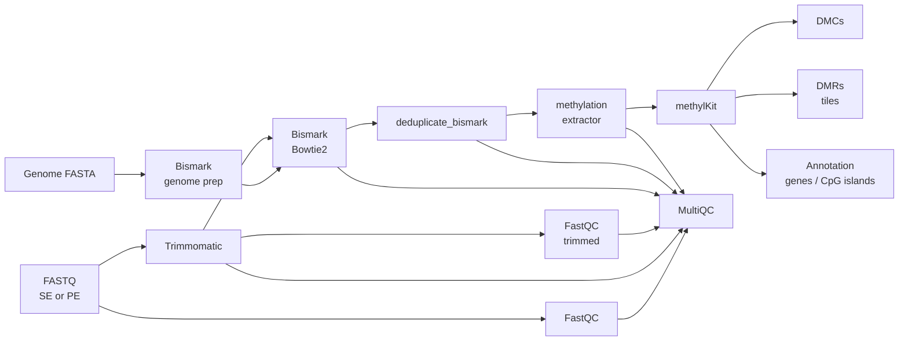

# DNA Methylation Analysis Pipeline (Bisulfite-seq)

[](https://github.com/kashyapshilpi/DNA-methylation-analysis/actions/workflows/ci.yml)
[](https://www.nextflow.io/)
[](https://docs.conda.io/)
[](https://www.docker.com/)

A Nextflow (DSL2) pipeline for whole-genome bisulfite sequencing: from raw reads to differentially methylated CpGs and regions, with optional gene and CpG-island annotation. Supports single-end and paired-end libraries. Every push is tested end-to-end on public data by GitHub Actions.

## Workflow



## Quick start

Requires [Nextflow](https://www.nextflow.io/docs/latest/install.html) ≥ 24.04 and either conda or Docker.

Try it on the bundled public test data (from nf-core/test-datasets):

```bash
nextflow run kashyapshilpi/DNA-methylation-analysis -profile test,docker
# or
nextflow run kashyapshilpi/DNA-methylation-analysis -profile test,conda
```

Run on your own data:

```bash
nextflow run kashyapshilpi/DNA-methylation-analysis -profile docker \
    --input samplesheet.csv \
    --fasta genome.fa \
    --genes_bed genes.bed12 \
    --cpg_bed cpg_islands.bed \
    --outdir results
```

## Samplesheet

Leave `fastq_2` empty for single-end samples.

```csv
sample,fastq_1,fastq_2,condition
SHOOT_1,/data/shoot1_R1.fastq.gz,/data/shoot1_R2.fastq.gz,treatment
SHOOT_2,/data/shoot2_R1.fastq.gz,/data/shoot2_R2.fastq.gz,treatment
ROOT_1,/data/root1_R1.fastq.gz,/data/root1_R2.fastq.gz,control
ROOT_2,/data/root2_R1.fastq.gz,/data/root2_R2.fastq.gz,control
```

## Parameters

| Parameter | Default | Description |
|---|---|---|
| `--input` | – | Samplesheet CSV (required) |
| `--fasta` | – | Reference genome FASTA (required) |
| `--outdir` | `results` | Output directory |
| `--contrast_reference` | `control` | Reference condition |
| `--contrast_target` | `treatment` | Condition compared against the reference |
| `--min_cov` | `10` | Minimum reads per CpG |
| `--diff_cutoff` | `25` | Minimum % methylation difference for DMCs/DMRs |
| `--qvalue` | `0.01` | Maximum q-value |
| `--tile_size` | `1000` | Window size (bp) for DMR tiling |
| `--genes_bed` | – | Optional 12-column transcript BED for gene-part / TSS annotation |
| `--cpg_bed` | – | Optional CpG-island BED for island / shore annotation |
| `--non_directional` | `false` | Align to all four bisulfite strands |
| `--assembly` | `genome` | Assembly label stored in methylKit objects |
| `--min_len` | `36` | Minimum read length after trimming |

Overdispersion-corrected tests (McCullagh–Nelder, χ²) are used automatically when both groups have replicates.

## Profiles

| Profile | What it does |
|---|---|
| `conda` / `mamba` | Creates a conda environment per step from bioconda / conda-forge |
| `docker` | Runs each step in a container built from the same conda packages via [Wave](https://seqera.io/wave/) |
| `test` | Small public dataset for a quick end-to-end check |

## Outputs

| Folder | Contents |
|---|---|
| `fastqc_raw/`, `fastqc_trimmed/` | Per-sample read QC |
| `trimmomatic/` | Trimmed reads and logs |
| `bismark_align/`, `bismark_dedup/` | Alignments and deduplicated BAMs with reports |
| `bismark_extract/` | `*.bismark.cov.gz` coverage files, bedGraphs, M-bias and splitting reports |
| `methylkit/` | `DMC_all/hyper/hypo.tsv`, `DMR_tiles.tsv`, `CpG_all_tested.tsv`, QC, sample-similarity, per-chromosome and annotation plots |
| `multiqc/multiqc_report.html` | Combined QC report, including Bismark alignment, deduplication and M-bias |
| `pipeline_info/` | Nextflow execution report, timeline and trace |

## Repository layout

```
main.nf              workflow
nextflow.config      parameters, resources, profiles
modules/             one process per tool
bin/                 methylKit analysis script used by the pipeline
conf/test.config     public test dataset
assets/              test samplesheet, adapter sequences
extras/              GeneDMRs alternative DMR analysis (standalone R script)
.github/workflows/   CI: stub run + end-to-end conda test
```

## Background

Built from my MSc dissertation at CSIR–IHBT, where I studied tissue-specific DNA methylation in *Sorghum bicolor* using WGBS (NCBI BioProject PRJNA289892), and rebuilt as a reproducible, tested Nextflow pipeline.

## License

MIT. See [licence.txt](licence.txt).
